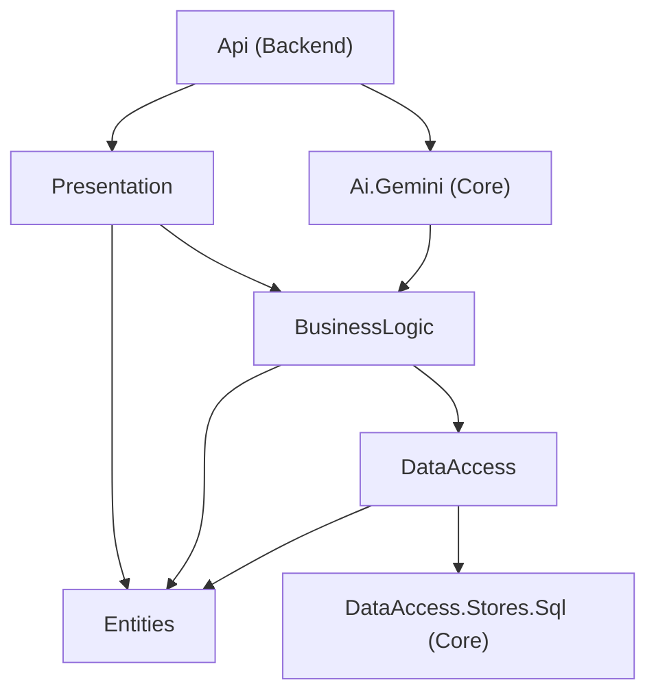

# Reclamos Urbanos

API REST y aplicación web para registrar y dar seguimiento a reclamos urbanos (baches, fallas del alumbrado público y acumulación de basura), con inteligencia artificial que ayuda a clasificarlos y priorizarlos.

Proyecto del **Grupo F** (Carranza L., Carrizo y Saavedra).

## Impacto social

Los reclamos de los vecinos suelen llegar de forma desordenada y sin criterio de urgencia. Este sistema permite que cualquier persona describa el problema **con sus propias palabras** y recibe, antes de registrarlo, una sugerencia de categoría, prioridad y resumen. El municipio obtiene reclamos ordenados por categoría, barrio, estado y prioridad, y puede atender primero lo más urgente.

La inteligencia artificial **solo sugiere**: la persona revisa y corrige los datos antes de guardar. Ante delitos, violencia o emergencias, el sistema indica llamar al 911.

## Funcionalidades

- Registro de reclamos con descripción libre, dirección, categoría y barrio.
- Sugerencia automática de categoría, prioridad y resumen con Google Gemini, editable por el usuario.
- Aviso de emergencia (llamar al 911) ante delitos, violencia, personas heridas, incendios o emergencias médicas.
- Panel de gestión con indicadores (total, pendientes, en proceso y resueltos), listado, buscador, filtros por categoría, barrio, estado y prioridad, y cambio de estado.
- Administración de categorías y barrios mediante la API, con protección de integridad (no se pueden borrar si tienen reclamos asociados).

## Arquitectura

El backend sigue una arquitectura **en N capas**. Cada capa solo depende de las inferiores:



| Proyecto | Carpeta | Responsabilidad |
|---|---|---|
| `ReclamosUrbanos.Api` | `Backend/` | Punto de entrada: configuración, inyección de dependencias, CORS |
| `ReclamosUrbanos.Presentation` | `Layers/` | Controllers REST y DTOs |
| `ReclamosUrbanos.BusinessLogic` | `Layers/` | Managers con las reglas de negocio y el contrato `IAiService` |
| `ReclamosUrbanos.DataAccess` | `Layers/` | `AppDbContext`, stores, configuraciones de EF Core y migraciones |
| `ReclamosUrbanos.Entities` | `Layers/` | Entidades y enumeraciones |
| `ReclamosUrbanos.DataAccess.Stores.Sql` | `Core/` | `BaseSqlStore<TEntity>`: operaciones CRUD genéricas y asíncronas |
| `ReclamosUrbanos.Ai.Gemini` | `Core/` | Implementación de `IAiService` con Google Gemini |

La IA se integra mediante una **interfaz** (`IAiService`) registrada por **inyección de dependencias**, de modo que el proveedor puede cambiarse sin tocar la lógica de negocio.

## Tecnologías

- **Backend:** C#, .NET 10, ASP.NET Core Web API, Entity Framework Core 10, PostgreSQL (Npgsql).
- **IA:** Google Gemini (modelo configurable, por defecto `gemini-3.5-flash-lite`).
- **Frontend:** Next.js 16 (App Router), React 19, TypeScript y Tailwind CSS 4.

## Estructura del repositorio

```
Reclamos_Urbanos/
├── ReclamosUrbanos.slnx
├── Backend/ReclamosUrbanos.Api
├── Layers/
│   ├── ReclamosUrbanos.Entities
│   ├── ReclamosUrbanos.DataAccess
│   ├── ReclamosUrbanos.BusinessLogic
│   └── ReclamosUrbanos.Presentation
├── Core/
│   ├── ReclamosUrbanos.DataAccess.Stores.Sql
│   └── ReclamosUrbanos.Ai.Gemini
└── Frontend/                 (Next.js; ver Frontend/README.md)
```

## Cómo ejecutarlo

**Requisitos:** SDK de .NET 10, Node.js 20.9 o superior, PostgreSQL (probado con la versión 18), Git y una clave gratuita de Gemini (<https://aistudio.google.com/apikey>).

### 1. Clonar el repositorio

```powershell
git clone https://github.com/leandrodcarranza/Reclamos_Urbanos.git
cd Reclamos_Urbanos
```

### 2. Configurar los secretos de la API

La contraseña de PostgreSQL y la clave de Gemini **no se guardan en el repositorio**: se cargan en los *user secrets* de cada desarrollador.

```powershell
dotnet user-secrets set "ConnectionStrings:DefaultConnection" "Host=localhost;Port=5432;Database=reclamos_urbanos;Username=postgres;Password=TU_CONTRASEÑA" --project Backend/ReclamosUrbanos.Api
dotnet user-secrets set "Gemini:ApiKey" "TU_CLAVE_DE_GEMINI" --project Backend/ReclamosUrbanos.Api
```

En Visual Studio también se pueden editar con clic derecho sobre el proyecto `Api` → *Administrar secretos de usuario*.

### 3. Crear la base de datos

Instalar la herramienta de EF Core (una sola vez) y aplicar la migración. Si la base `reclamos_urbanos` no existe, se crea sola y se cargan los datos iniciales (categorías Bache, Alumbrado y Basura, y cuatro barrios de Córdoba).

```powershell
dotnet tool install --global dotnet-ef
dotnet ef database update --project Layers/ReclamosUrbanos.DataAccess --startup-project Backend/ReclamosUrbanos.Api
```

Si EF muestra un error de conexión y luego termina en `Done.`, es normal: estaba creando la base.

### 4. Ejecutar la API

```powershell
dotnet run --project Backend/ReclamosUrbanos.Api --launch-profile http
```

Queda disponible en `http://localhost:5121`. Debe usarse el perfil **`http`**: la API permite CORS solo desde `http://localhost:3000`.

### 5. Ejecutar el frontend

En otra terminal:

```powershell
cd Frontend
copy .env.example .env.local
npm install
npm run dev
```

Abrir <http://localhost:3000>. En el encabezado debe decir **"API conectada"**.

## Modelo de datos

| Tabla | Campos |
|---|---|
| `Categories` | `Id`, `Name` (único, máx. 100), `Description` (máx. 500) |
| `Neighborhoods` | `Id`, `Name` (único, máx. 100) |
| `Reports` | `Id`, `Description`, `Address` (máx. 200), `Summary`, `CategoryId`, `NeighborhoodId`, `Status`, `Priority`, `CreatedAt` |

- `Status`: `Pending`, `InProgress`, `Resolved`.
- `Priority`: `Low`, `Medium`, `High`.
- Las claves foráneas de `Reports` usan `Restrict`: no se puede borrar una categoría o un barrio que tenga reclamos asociados.

## API REST

Los enumerados viajan como texto. Códigos de respuesta: `200` consulta correcta, `201` creación, `204` modificación o borrado correcto, `400` datos inválidos (incluye categoría o barrio inexistentes), `404` no existe y `409` conflicto (nombre duplicado o registro en uso).

### Reclamos

| Método | Ruta | Descripción |
|---|---|---|
| `GET` | `/api/reports` | Lista los reclamos. Filtros opcionales: `categoryId`, `neighborhoodId`, `status`, `priority` |
| `GET` | `/api/reports/{id}` | Consulta un reclamo |
| `POST` | `/api/reports` | Crea un reclamo |
| `PUT` | `/api/reports/{id}` | Modifica un reclamo |
| `DELETE` | `/api/reports/{id}` | Elimina un reclamo |
| `PATCH` | `/api/reports/{id}/status` | Cambia el estado. El cuerpo es el valor como texto JSON, por ejemplo `"InProgress"` |
| `POST` | `/api/reports/analyze` | Pide a la IA una sugerencia. **No guarda nada** |

Ejemplo de `POST /api/reports`:

```json
{
  "description": "Hay un pozo enorme en Av. Colón al 1200, ayer se cayó una moto",
  "address": "Av. Colón 1200",
  "categoryId": 1,
  "neighborhoodId": 2,
  "priority": "High",
  "summary": "Pozo de gran tamaño en Av. Colón al 1200 que ya provocó la caída de una moto."
}
```

`priority` y `summary` son opcionales (la prioridad por defecto es `Medium`).

### Categorías y barrios

| Método | Ruta | Descripción |
|---|---|---|
| `GET` | `/api/categories` y `/api/neighborhoods` | Listar |
| `GET` | `/api/categories/{id}` y `/api/neighborhoods/{id}` | Consultar uno |
| `POST` | `/api/categories` y `/api/neighborhoods` | Crear |
| `PUT` | `/api/categories/{id}` y `/api/neighborhoods/{id}` | Modificar |
| `DELETE` | `/api/categories/{id}` y `/api/neighborhoods/{id}` | Eliminar (`409` si tiene reclamos asociados) |

## Inteligencia artificial

El endpoint `POST /api/reports/analyze` recibe la descripción y devuelve:

```json
{
  "categoryId": 1,
  "priority": "High",
  "summary": "Pozo de gran tamaño en Av. Colón al 1200 que ya provocó la caída de una moto.",
  "isEmergency": false,
  "usedFallback": false
}
```

**Cómo funciona**

1. `ReportAnalysisManager` obtiene las categorías reales de la base y se las envía a Gemini junto con la descripción.
2. Gemini responde en JSON con un esquema definido (temperatura baja, límite de 20 segundos).
3. La respuesta se **valida**: la categoría debe existir (si no, queda en `null`), la prioridad debe ser válida y el resumen se limita a 200 caracteres.

**Salvaguardas**

- **La IA sugiere, la persona decide.** Si no puede determinar la categoría, devuelve `categoryId: null` y el usuario la elige.
- **Plan B:** si Gemini falla o tarda demasiado, se devuelve `usedFallback: true`, categoría vacía y prioridad `Medium`, en lugar de un error.
- **Casos ajenos al municipio** (por ejemplo un delito) se devuelven sin categoría y con prioridad `Low`.
- **Emergencias:** el indicador `isEmergency` lo marca la IA y, además, una detección por palabras clave en el backend funciona aunque la IA falle. Cuando es `true`, el resumen termina con "Ante una emergencia, llamá al 911." y el formulario muestra un aviso destacado.
- **Privacidad:** en el plan gratuito de Gemini, lo que se envía puede usarse para mejorar los productos de Google. Usar solo datos ficticios en pruebas y demostraciones. La clave nunca se sube al repositorio.

## Pruebas rápidas desde PowerShell

```powershell
Invoke-RestMethod http://localhost:5121/api/categories
Invoke-RestMethod http://localhost:5121/api/reports?status=Pending
Invoke-RestMethod -Method Post -Uri http://localhost:5121/api/reports/analyze -ContentType "application/json" -Body '{"description":"La luz de la esquina esta apagada hace una semana"}'
```

## Forma de trabajo del equipo

- La rama `main` está protegida: todo cambio entra por *pull request* con una aprobación de otra persona.
- Cada tarea va en su rama (`feature/...` o `fix/...`) y se integra con *Squash and merge*.
- Antes de generar una migración se actualiza `main`. Una vez mergeada, `InitialCreate` no se edita: los cambios de modelo van en migraciones nuevas.

## Limitaciones y mejoras futuras

- No hay autenticación ni roles (ciudadano y municipio).
- Los filtros del listado se aplican en memoria y no hay paginación: alcanza para esta escala, pero habría que pasarlos a la consulta de base de datos.
- No hay pruebas automatizadas.
- La IA depende de un servicio externo y de los límites del plan gratuito.
- Las categorías son fijas; no hay una categoría para otros problemas de infraestructura (por ejemplo instalaciones eléctricas).

## Integrantes

- **Leandro:** esqueleto del proyecto, infraestructura compartida (`BaseSqlStore`, `AppDbContext`, migración), integración con la IA y base del frontend.
- **Franco:** módulo de reclamos (backend) y panel de gestión (frontend).
- **Mauricio:** módulos de categorías y barrios (backend) y formulario de nuevo reclamo (frontend).
